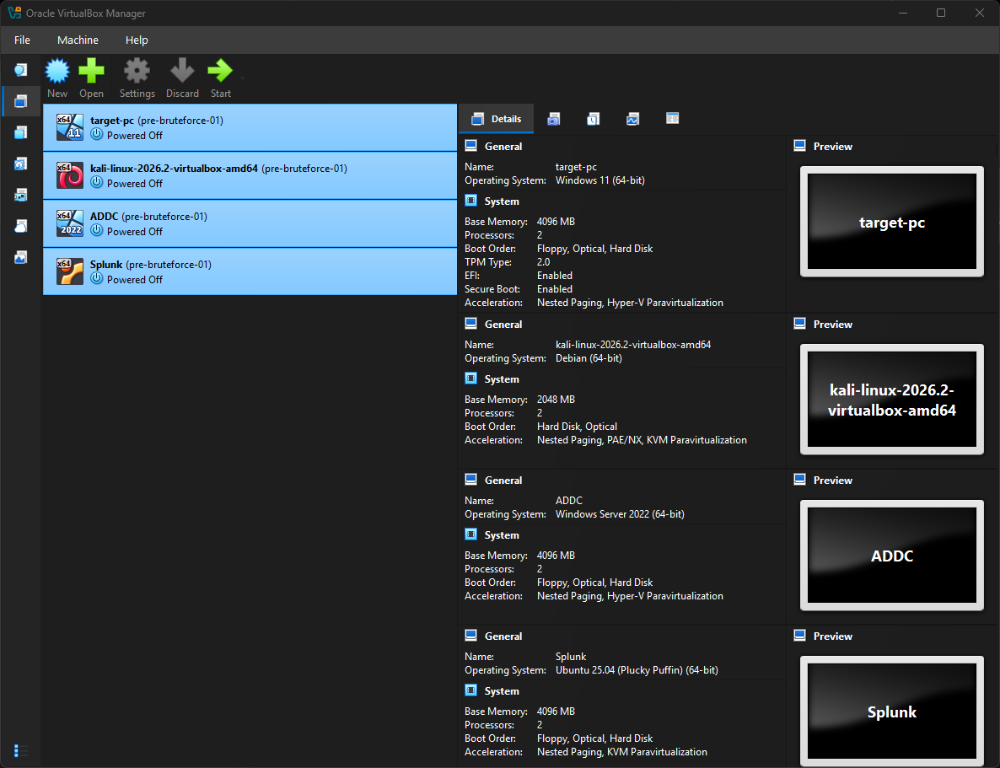

# Active Directory Home Lab with Splunk SIEM

Virtualized SOC environment on a single host with VirtualBox. Kali attacks a Windows AD domain (`ADLAB`), Splunk collects Windows Event Logs and Sysmon so I can see how each attack looks and figure out detection.

**Status:** 🚧 In progress. Splunk, log forwarding, AD, and one attack scenario done (RDP brute force). Adding more.

## Ethics & Scope

This is an isolated lab. All VMs on a private VirtualBox NAT network, no bridge to anything real. Credentials are weak and lab-only, no real accounts or data involved. The point is learning detection, not writing an attack guide.

## Skills Demonstrated

SIEM deployment and SPL searching · endpoint telemetry (Sysmon, Windows Event Logs) · AD administration · attack simulation (Kali, Hydra, Atomic Red Team) · MITRE ATT&CK mapping · detection engineering · virtual networking · troubleshooting

## Lab Architecture

All VMs on `192.168.10.0/24`, isolated from the host network.

| Role | Host | IP |
|---|---|---|
| Attacker | Kali Linux | 192.168.10.250 |
| Domain Controller | ADLAB DC | 192.168.10.7 |
| Target | target.adlab.local (Win11) | 192.168.10.100 |
| SIEM | Splunk Enterprise (Ubuntu) | 192.168.10.10 |

Logs forward to Splunk via Universal Forwarder (port 9997) into the `endpoint` index.

## Attack Scenarios

| # | Scenario | MITRE | Status |
|---|---|---|---|
| 01 | [RDP Brute Force](attacks/01-rdp-brute-force.md) | T1110.001 | ✅ |
| 02 | [Atomic Red Team: Create Local Account](attacks/02-atomic-red-team-t1136.md) | T1136.001 | 🚧 |

More in progress.

## Notes

- Screenshots have creds scrubbed, lab passwords only.
- Kali and Windows VMs aren't NTP synced, timestamps can be off by host. Events get matched by source IP + order instead (noted per scenario).

## References

Built following along with [Video Title](https://youtube.com/watch?v=...) by [Creator Name], adapted for this lab's domain setup, deviations documented per scenario.
