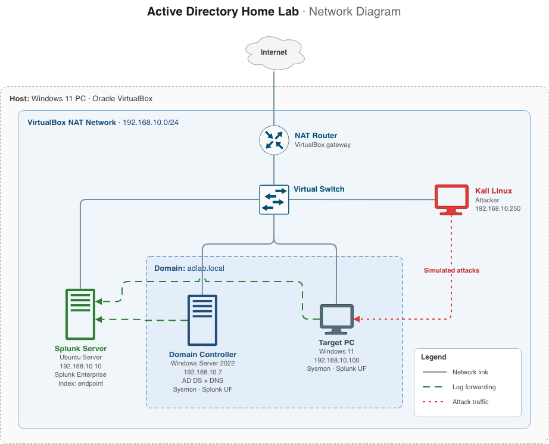

# Active Directory Home Lab with Splunk SIEM

Virtualized SOC environment on a single host with VirtualBox. Kali attacks a Windows AD domain (`ADLAB`), Splunk collects Windows Event Logs and Sysmon so I can see how each attack looks and figure out detection.

**Status:** In progress. Splunk, log forwarding, AD, and one attack scenario done (RDP brute force). Adding more.

## Ethics & Scope

This is an isolated lab. All VMs on a private VirtualBox NAT network, no bridge to anything real. Credentials are weak and lab-only, no real accounts or data involved. The point is learning detection, not writing an attack guide.

## Skills Demonstrated

SIEM deployment and SPL searching · endpoint telemetry (Sysmon, Windows Event Logs) · AD administration · attack simulation (Kali, Hydra, Atomic Red Team) · MITRE ATT&CK mapping · detection engineering · virtual networking · troubleshooting

## Lab Architecture

All VMs on `192.168.10.0/24`, isolated from the host network.

| Role              | Hostname | OS                  | IP             |
| ----------------- | -------- | ------------------- | -------------- |
| Attacker          | kali     | Kali Linux          | 192.168.10.250 |
| Domain Controller | ADDC     | Windows Server 2022 | 192.168.10.7   |
| Target            | target   | Windows 11          | 192.168.10.100 |
| SIEM              | splunk   | Ubuntu + Splunk     | 192.168.10.10  |

Logs forward to Splunk via Universal Forwarder (port 9997) into the `endpoint` index.

## Lab Setup

The `setup/` docs cover build steps and configuration choices that go beyond the reference tutorial, explaining decisions and deviations specific to this lab.

User accounts are bulk-created from a CSV with a PowerShell script —
see [`scripts/`](scripts/). This populates the domain so the attack
scenarios have realistic targets.

## Attack Scenarios

| #   | Scenario                                                                     | MITRE     | Status      |
| --- | ---------------------------------------------------------------------------- | --------- | ----------- |
| 01  | [RDP Brute Force](attacks/01-rdp-brute-force.md)                             | T1110.001 | Complete    |
| 02  | [Atomic Red Team: Create Local Account](attacks/02-atomic-red-team-t1136.md) | T1136.001 | In progress |

## Repository Structure

`attacks/` — attack scenario docs
`setup/` — setup docs for choices beyond the reference tutorial
`scripts/` — automation scripts used in lab
`diagrams/` — network architecture
`screenshots/` — evidence referenced by the docs

## Notes

- Screenshots have creds scrubbed, lab passwords only.
- All hosts are NTP-synced to the DC (which syncs to pool.ntp.org); see setup/time-sync.md

## References

Initial setup based on [Active Directory Project (Home Lab) | Part 1](https://youtu.be/mWqYyl89QaY?si=fmHBQ2l9rT1TuFhJ) by [MyDFIR](https://www.youtube.com/@MyDFIR)